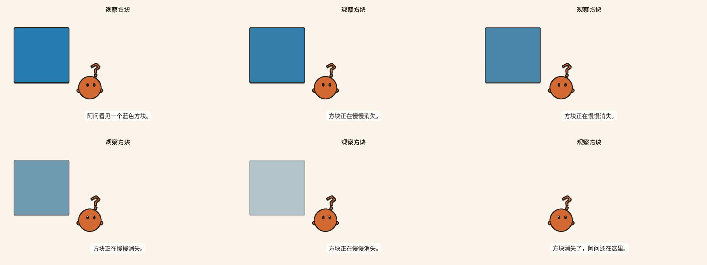
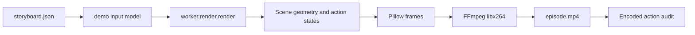

English | [中文](README.zh.md)

# Tellkit 0.1.0

## Why

Render an instructional video from an explicit storyboard using code-generated frames. This release provides a complete offline example with two scenes, Chinese captions, a character and an audited disappearance action. No model service, API key or GPU is required.

## Quick Start

Use Python **3.12**, FFmpeg and ffprobe on PATH. FFmpeg must include `libx264`.

```sh
python3 -m venv .venv
. .venv/bin/activate
pip install -r requirements.txt
python demo/run.py
ffprobe -v error -select_streams v:0 -show_entries stream=width,height,nb_frames,duration -of json out/episode.mp4
```

Expected: 16 seconds, 480 frames, 1280 × 720 at 30 fps. After installing dependencies, rendering needs no network. Fonts are bundled.

The demo has a silent audio track, with narration shown as captions. A full product connects TTS here; this demo deliberately leaves it out so you need no model API keys.

Alternatively:

```sh
docker build -t tellkit-render .
docker run --rm -v "$PWD/out:/opt/tellkit/out" tellkit-render
```

The Docker recipe is supplied; local verification uses an isolated Python environment. Inputs and output paths resolve relative to the repository, independent of the current directory. `FFMPEG`, `TELLKIT_FONT_DIR` and `TELLKIT_FALLBACK_FONT` can override binary and font discovery.

  
6 frames sampled from the 16 s render

## Architecture



`demo/offline.py` installs explicit input and diagnostic adapters before importing the renderer. They avoid loading generation and content-review services. Reported hard findings block rendering; other visual findings are recorded in `out/offline-diagnostics.json`; these adapters do not make content acceptance decisions. Geometry exceptions and encoded action checks still run in the unchanged renderer. The two-scene input model is intentionally separate from the service model's scene-count requirement.

The demo directly calls `worker.render.render`. The service caller also imports that function in `worker/pipeline.py` and invokes it for video jobs. See [entry-point evidence](demo/entrypoints.md).

## How a frame is drawn

Each scene receives a local time derived from the 30 fps timeline. The renderer resolves explicit objects into stage geometry, applies action states and lighting, draws shapes with Pillow, and adds labels and captions using bundled fonts. Frame bytes stream to FFmpeg as RGB24. The renderer generates sample-aligned silent audio, muxes AAC with H.264, and checks action evidence against decoded movie frames. Geometry declarations, frame hashes and timing measurements remain in `out/`.

The second scene makes the block disappear through the renderer's existing opacity action. No drawing thresholds, font sizes or geometry formulas are changed for this example.

## Repository structure

- `demo/`: fixed input, offline entry, adapters and delivery records.
- `worker/`: drawing, actions, frame scheduling and encoding.
- `app/`: supporting geometry, schema and rendering contracts required at runtime.
- `assets/`: bundled OFL fonts and original license texts.
- `contracts/`: API and storyboard contracts.
- `docs/adr/`: twenty bounded decision records.
- `out/`: bundled `episode.mp4`; locally generated evidence is ignored.

[Delivery inventory](demo/inventory.md) identifies each added dependency and its importing caller. [Third-party licenses](demo/dependency-licenses.json) record the installed dependency audit.

## ADR index

See the [twenty decision records](demo/adr-index.md).

Start with [0002 — Delivery ingress](docs/adr/0002.md) (cross-border TTFB from 1.2–2.4s to 0.38s), [0009 — Memory failures](docs/adr/0009.md) (tracing orphan render subprocesses that exhaust memory), and [0017 — Fixed input for offline execution](docs/adr/0017.md) (why the demo uses fixed input).

## Limitations

This example demonstrates one manually authored board and one landscape output. It does not generate scripts, synthesize speech, review content or run a web service. Supporting shapes and actions are bounded by the bundled implementation. Arbitrary edited boards can fail geometry or glyph validation. Package installation and Docker builds require network access; the render itself does not. The Docker image has not been built as part of local verification.

This release is published as-is. Pull requests and issues are closed. No support, no roadmap.

## License

Code: [Apache-2.0](LICENSE). Fonts: SIL OFL 1.1 with their original notices. FFmpeg is installed separately; the Docker recipe selects a GPL-enabled build with libx264. See [NOTICE](NOTICE).
