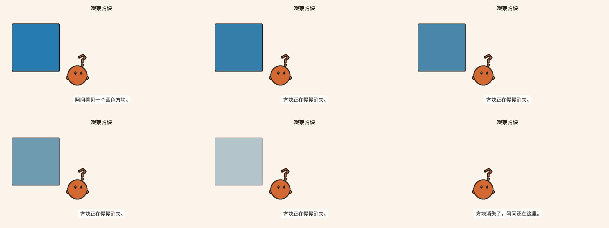

[English](README.md) | 中文

# Tellkit 0.1.0

## 为什么

从明确的分镜数据绘制教学短片。本版本提供完整离线示例：两场画面、中文字幕、角色和带成片验证的消失动作。不需要模型服务、接口密钥或显卡。

## 快速开始

需要 **Python 3.12**，以及可从命令行调用的 FFmpeg、ffprobe。FFmpeg 必须包含 `libx264` 编码器。

```sh
python3 -m venv .venv
. .venv/bin/activate
pip install -r requirements.txt
python demo/run.py
ffprobe -v error -select_streams v:0 -show_entries stream=width,height,nb_frames,duration -of json out/episode.mp4
```

预期得到 16 秒、480 帧、1280 × 720、每秒 30 帧的视频。依赖安装完成后，渲染不需要网络，字体已随目录提供。

演示片的音轨是静音，旁白以字幕呈现。真实产品在这一层接 TTS；这里刻意不接，好让 demo 不需要任何模型的 key。

也可以使用容器：

```sh
docker build -t tellkit-render .
docker run --rm -v "$PWD/out:/opt/tellkit/out" tellkit-render
```

容器构建文件已提供，本地验收使用隔离的 Python 环境。输入和输出相对仓库定位，不依赖启动目录。可通过 `FFMPEG`、`TELLKIT_FONT_DIR`、`TELLKIT_FALLBACK_FONT` 指定编码器和字体路径。

  
取自 16 秒成片的 6 帧

## 架构

分镜文件依次经过示例输入模型、`worker.render.render`、场景几何与动作状态、Pillow 绘帧、FFmpeg 编码，最后验证成片动作。

`demo/offline.py` 在导入渲染器之前安装输入和诊断适配器，避免加载生成与内容审核服务。标记为硬错误的诊断会阻断渲染，其他画面诊断写入 `out/offline-diagnostics.json`，适配器不进行内容验收决策。原渲染器中的几何异常和成片动作验证仍会执行。两场示例使用独立输入模型，不沿用服务模型的场数限制。

示例直接调用 `worker.render.render`，服务调用端也从相同模块导入这个函数。见[入口证据](demo/entrypoints.md)。

## 一帧如何绘制

每帧按每秒 30 帧的时间线计算场景内时间。渲染器将对象声明转换为舞台几何，应用动作与光照状态，用 Pillow 绘制形状，再使用随附字体添加标签和字幕。RGB24 帧数据送入 FFmpeg，随后把按采样数对齐的静音音轨编码为 AAC，并与 H.264 视频合并。动作验证会读取编码后的视频帧，几何声明、帧哈希和耗时记录保存在输出目录。

第二场通过渲染器既有的透明度动作让方块消失。示例没有改变绘图阈值、字号或几何公式。

## 仓库结构

- `demo/`：固定输入、离线入口、适配器与交付记录。
- `worker/`：绘图、动作、帧调度和编码。
- `app/`：运行所需的几何、模型与渲染契约。
- `assets/`：开放字体及原始授权文本。
- `contracts/`：接口与分镜契约。
- `docs/adr/`：二十条决策记录。
- `out/`：交付成片 `episode.mp4`；本地生成的证据文件由版本控制忽略。

[交付清单](demo/inventory.md)逐项说明补充依赖及其调用方。[第三方许可证记录](demo/dependency-licenses.json)列出实际安装环境的审计结果。

## 决策记录索引

见[二十条决策记录](demo/adr-index.md)。

建议先读 [0002 — Delivery ingress](docs/adr/0002.md)（跨境 TTFB 从 1.2–2.4s 到 0.38s 的取舍）、[0009 — Memory failures](docs/adr/0009.md)（渲染孤儿子进程吃满内存的排查路径）和 [0017 — Fixed input for offline execution](docs/adr/0017.md)（为什么 demo 使用固定输入）。

## 限制

示例只演示一份手写分镜和一种横屏输出，不生成文案、不合成语音、不审核内容、不运行网页服务。形状和动作受随附实现范围约束，任意修改分镜可能触发几何或字形错误。安装依赖及构建容器需要网络，渲染本身不需要。此次本地验收未构建容器镜像。

本版本按现状发布，不接收合并请求或问题单，不提供支持或后续路线承诺。

## 许可证

代码采用 [Apache-2.0](LICENSE)。字体遵循 SIL OFL 1.1 并保留原始声明。FFmpeg 单独安装，容器构建文件使用包含 libx264 的 GPL 版本。见 [NOTICE](NOTICE)。
